# Mini Jira

A lightweight issue tracker with a drag-and-drop Kanban board and per-project roles. I built it to practice full-stack work end to end: authentication, relational-style data in MongoDB, server-side authorization, and optimistic UI.

**Live demo:** https://mini-jira-tan.vercel.app (sign in with any GitHub account; you only see projects you create or are added to)

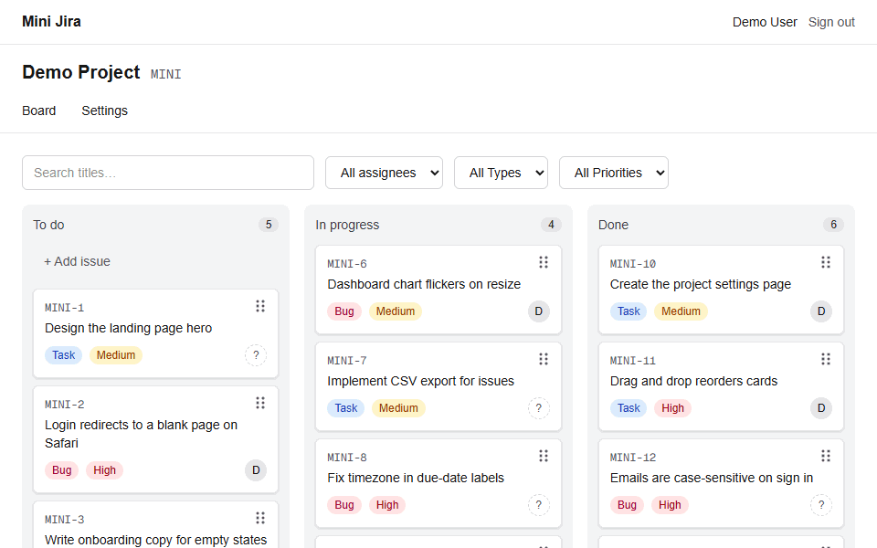

| Light | Dark | Phone (375 px) |
|---|---|---|
| 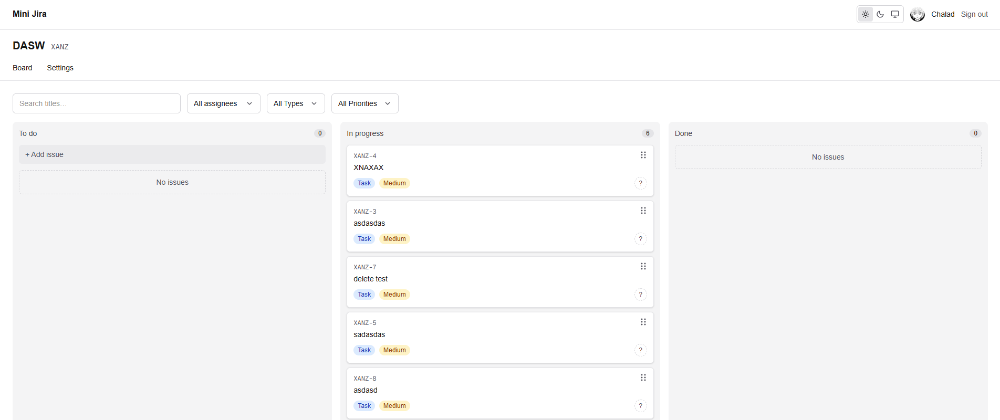 | 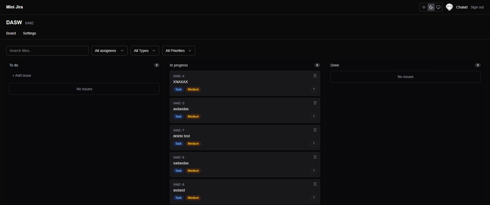 | 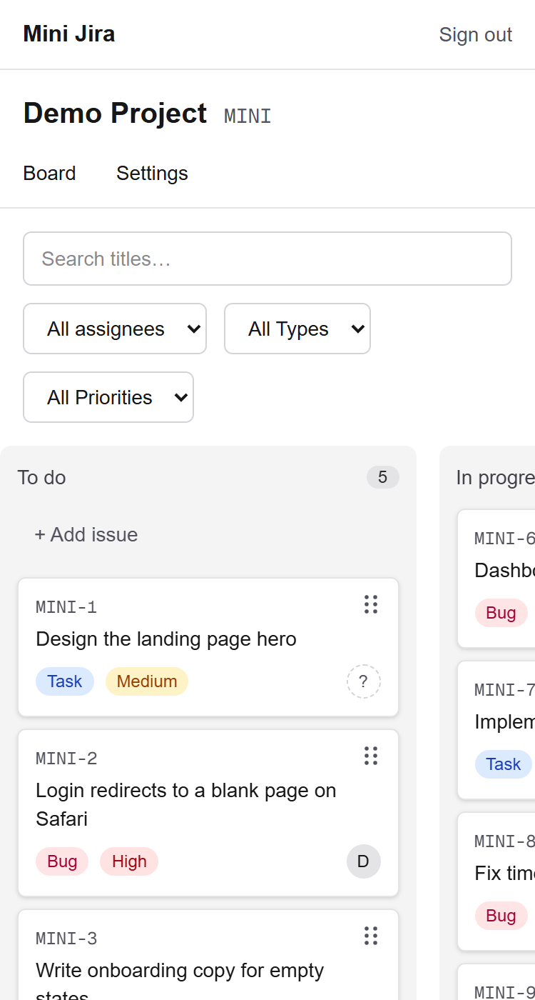 |

### More screens

| | |
|---|---|
| 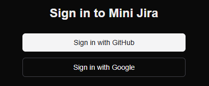<br>**Sign in** with GitHub or Google (same verified email = same account). | 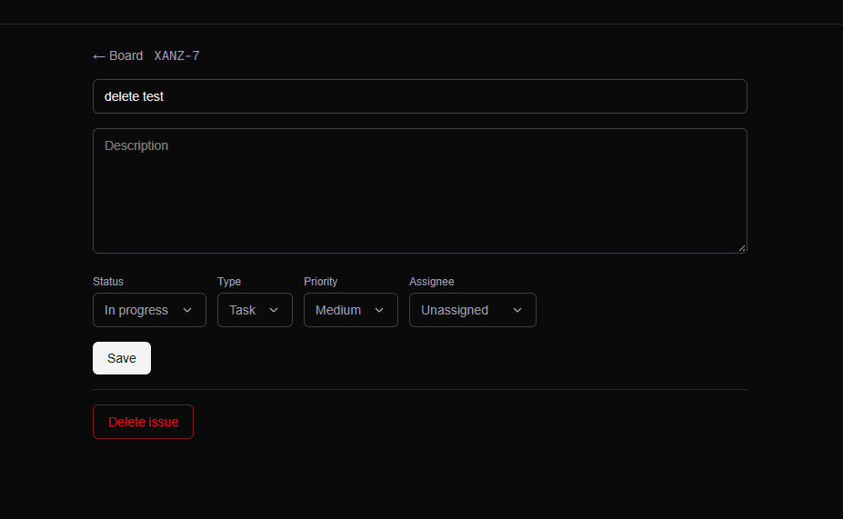<br>**Issue detail**: edit every field; Delete shows for admins only. |
| 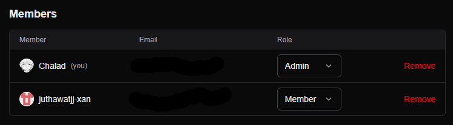<br>**Members and roles** (Settings, admins only). The last admin cannot be demoted or removed. | 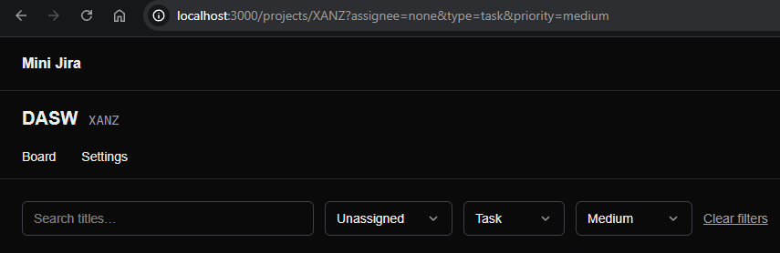<br>**Filters live in the URL**, so a refresh or a shared link shows the same board. |
| 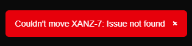<br>**A failed move rolls back** and a toast says why (here the issue had just been deleted). | 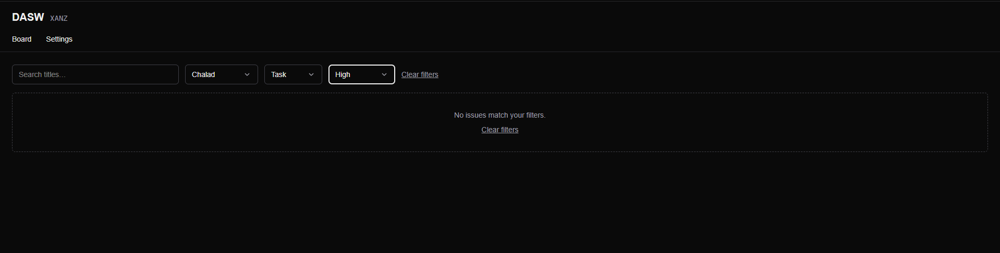<br>**Empty state** when the filters match nothing, with a way out. |
| 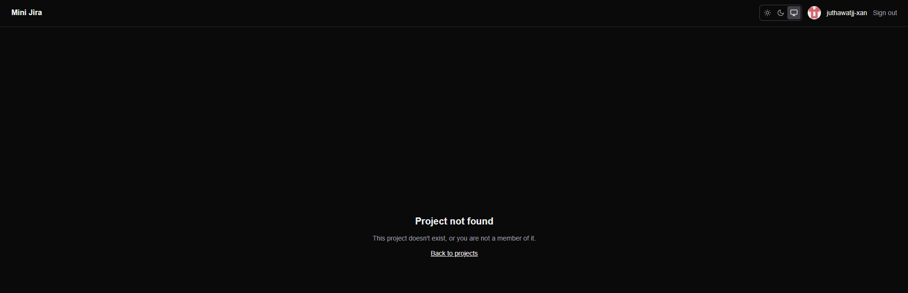<br>**No hint that a project exists**: non-members get the same "not found" page as for a project that does not exist. | |

---

## Features

| Feature | Status |
|---|---|
| Sign in with GitHub or Google (Auth.js, JWT sessions); the same verified email is the same user | ✅ |
| Projects with short keys (e.g. `MJ` → `MJ-1`, `MJ-2`) | ✅ |
| Issues: create / edit / delete, type, priority, assignee | ✅ |
| Kanban board with drag & drop (To do / In progress / Done), mouse, touch and keyboard | ✅ |
| Per-project roles: **Admin** and **Member** | ✅ |
| Add members by email, change roles, remove members, last-admin guard | ✅ |
| Filters and title search on the board, kept in the URL | ✅ |
| Theme switch: Light / Dark / System (remembered in the browser), responsive down to 375 px | ✅ |
| Optional alert to n8n (→ LINE) when a high-priority issue appears (created as high, or raised to high), signed and never blocking | ✅ |
| Demo data script (`npm run seed`) | ✅ |

## Tech stack

- **Framework:** Next.js 16 (App Router, Server Actions, Cache Components, Turbopack), React 19, TypeScript
- **Styling:** Tailwind CSS 4
- **Database:** MongoDB Atlas + Mongoose
- **Auth:** Auth.js v5 (GitHub OAuth and Google OIDC, JWT sessions, no database adapter)
- **Drag & drop:** dnd-kit
- **Validation:** Zod
- **Tests:** Vitest
- **Deploy:** Vercel + MongoDB Atlas (free tiers)

## Architecture

```
Browser ──► Next.js (App Router)
              ├─ Server Components  → read data (projects, board)
              ├─ Server Actions     → every write (create/move/delete issue, manage members)
              │     └─ permission check on the server, every time
              ├─ proxy.ts           → first line of defense: signed-out users go to /login
              └─ Auth.js            → GitHub OAuth, session in a signed JWT
                        │
                        ▼
                 MongoDB Atlas (users, projects, issues)
```

Writes go through Server Actions, not public REST endpoints. Each action loads the caller's membership and checks the role **on the server** before touching the database. Hiding a button in the UI is only for UX, not for security. Every action input is validated with Zod; client-sent ids are always looked up *inside* the caller's project.

## Data model

```ts
User    { name, email (unique), image, createdAt, updatedAt }

Project { name, key (unique, 2–6 uppercase letters), ownerId,
          members: [{ userId, role: "admin" | "member" }],
          issueCounter, createdAt, updatedAt }

Issue   { projectId, number, title, description,
          status: "todo" | "in_progress" | "done",
          priority: "low" | "medium" | "high",
          type: "task" | "bug",
          assigneeId?, reporterId, order, createdAt, updatedAt }
```

**Indexes**
- `Project.members.userId` lists the projects a user belongs to
- `Issue { projectId, number }` is unique, so the same project never has two `MJ-12`
- `Issue { projectId, status, order }` loads the board grouped by column, already sorted

## Permissions

| Action | Admin | Member |
|---|:---:|:---:|
| View board, create / edit issues, move cards | ✅ | ✅ |
| Delete issues | ✅ | ❌ |
| Add / remove members, change roles | ✅ | ❌ |
| Rename / delete project | ✅ | ❌ |

A project must always have at least one admin. The last admin cannot be demoted or removed. People who are not in a project get a 404 for it, so the page does not reveal that the project exists.

## Design decisions

- **Accounts are linked by email, so only verified emails count.** There is no database adapter, so Auth.js does no linking of its own: a `users` document is upserted by lower-cased email on every sign-in, whichever provider it came from. Same email through GitHub and Google gives the same `_id`, so memberships and issues follow the person. A Google account is accepted only when `email_verified` is `true`. Auth.js' own GitHub provider takes the primary email without checking `verified`, so `src/lib/github-profile.ts` replaces that lookup: a GitHub email is only used when GitHub reports it as verified (the public email is kept as before, since GitHub only lets a verified address be public). The name and avatar shown are the ones from the provider used last.
- **Roles live on the project, not on the user.** The same person can be an admin in one project and a member in another.
- **Issue numbers come from an atomic counter.** Creating an issue runs `$inc` on `Project.issueCounter` and uses the returned value. Numbers are never reused after a delete. The unique index catches anything that slips through.
- **Card order is a float, computed on the server.** A card dropped between two others gets the midpoint of their `order` values, so a move updates **one** document instead of renumbering the column. The client only says which two cards it landed between; the server reads their current values. When the gap gets below 0.001 (after about 20 drops into the same spot), the column is renumbered once in a single `bulkWrite`.
- **The last-admin guard lives inside the database update.** Demoting or removing an admin only matches while another admin exists (`$elemMatch` in the filter of the same `updateOne`), so two admins demoting each other at the same moment cannot leave a project without an admin.
- **Theme is a class, chosen by the user.** Dark mode is a `dark` class on `<html>` (Tailwind's `dark:` variant is redefined once in `globals.css`), set by a tiny inline script in `<head>` before the first paint and changed by the switch in the header. The choice (`light` / `dark`; nothing stored means *System*, which follows the OS live) lives in `localStorage`, so it is per browser and needs no server round trip. That keeps `/` and `/login` fully static, and `color-scheme` follows the class so native selects and scrollbars match too.
- **Alerts are fire-and-forget by design.** The webhook is scheduled with `after()` so it can never slow down or fail the issue action; on Vercel the function is kept alive until it finishes. The issue link is built from `APP_URL` or Vercel's own production domain rather than request headers, because anyone who can call a Server Action can send their own `x-forwarded-host`.
- **Optimistic board.** `useOptimistic` shows the move instantly; if the action fails, the card snaps back and a toast explains why.
- **Touch dragging uses a handle.** The cards are links inside a sideways-scrolling board, so a finger drags by the handle (`touch-action: none`) and a swipe anywhere else scrolls. Mouse and keyboard grab the whole card (keyboard: focus a card, Space to lift, arrow keys to move, Space to drop, Esc to cancel).
- **Filters live in the URL** (`?assignee=me&type=bug&q=login`), parsed with Zod on the server, so a refresh or a shared link shows the same board.
- **Cached DB connection.** In dev, Next.js re-evaluates modules on every save. The Mongoose connection is cached on `globalThis` so it doesn't open a new connection each time and use up Atlas's connection limit.
- **No passwords stored.** Sign-in is GitHub OAuth only, so the app never handles password hashes.

## Getting started

### Prerequisites
- Node.js 20.9+
- A MongoDB Atlas cluster (free M0 is fine)
- A GitHub OAuth App (callback URL `http://localhost:3000/api/auth/callback/github`)
- Optional: a Google OAuth client (see *Sign in with Google* below). Without it the Google button is hidden.

### Setup

```bash
git clone <repo-url> mini-jira
cd mini-jira
npm install
cp .env.example .env.local   # then fill in the values
npm run dev
```

Open http://localhost:3000 and sign in with GitHub. Atlas must allow your IP under *Network Access*.

### Environment variables

| Name | Description |
|---|---|
| `MONGODB_URI` | Atlas connection string, with the database name `/mini-jira` before `?` |
| `AUTH_SECRET` | Random secret for signing sessions (`npx auth secret`) |
| `AUTH_GITHUB_ID` | GitHub OAuth App client ID |
| `AUTH_GITHUB_SECRET` | GitHub OAuth App client secret |
| `AUTH_GOOGLE_ID` | Optional. Google OAuth client ID (ends in `.apps.googleusercontent.com`) |
| `AUTH_GOOGLE_SECRET` | Optional. Google OAuth client secret. The Google button shows only when both Google variables are set. |
| `N8N_WEBHOOK_URL` | Optional. n8n webhook to notify (see *Alerts to n8n*). Empty = no alerts, nothing logged. |
| `N8N_WEBHOOK_SECRET` | Optional. Shared secret used to sign the alert (HMAC-SHA256). Required when the URL is set; without it nothing is sent. |
| `APP_URL` | Optional. Public address used in the issue link of an alert. On Vercel the production domain is used if this is empty. |

Never commit `.env.local`. It is already in `.gitignore`.

### Sign in with Google (optional)

1. In the [Google Cloud Console](https://console.cloud.google.com/) create or pick a project. *APIs & Services → OAuth consent screen*: user type **External**, fill in the app name and your email, scopes `openid`, `email`, `profile`. While the app is in **Testing**, add your Google account under *Test users* (only they can sign in until you publish the app).
2. *Credentials → Create credentials → OAuth client ID → Web application*. Add the **Authorized redirect URIs**: `http://localhost:3000/api/auth/callback/google` and, for production, `https://<your-production-domain>/api/auth/callback/google`.
3. Put the client ID and secret in `.env.local` as `AUTH_GOOGLE_ID` and `AUTH_GOOGLE_SECRET` (and in Vercel for production), then restart the server. The static landing and login pages read these at build time, so on Vercel the new variables need a redeploy.

The same email through GitHub and Google is **one user**: they get the same projects. Google sign-ins are refused unless Google reports the email as verified.

### Alerts to n8n (optional)

When an issue is **created as high**, or its priority is **raised to high**, Mini Jira POSTs a small JSON message to `N8N_WEBHOOK_URL`:

```json
{ "event": "issue.created", "label": "🆕 New HIGH issue", "projectKey": "MJ", "number": 12, "title": "…", "priority": "high",
  "assignee": "Ann", "url": "https://…/projects/MJ/issues/12", "sentAt": "2026-10-23T08:00:00.000Z" }
```

The header `X-Signature: sha256=<hex>` is the HMAC-SHA256 of the exact body with `N8N_WEBHOOK_SECRET`. The call runs after the action has answered (Next's `after()`), with a 3 second timeout: a slow, dead or erroring n8n never blocks or fails an issue action, it only logs one line (never the URL, the secret or the body). If `N8N_WEBHOOK_URL` is not set, nothing happens. Medium and low issues never send anything, and saving an issue that was already high does not send again. `label` (`🆕 New HIGH issue` or `🔴 Raised to HIGH`) is ready-to-show wording, so n8n does not have to translate `event`.

My n8n runs on my own machine behind ngrok, so **alerts only arrive while that machine, n8n and ngrok are on**. There are no retries; a message sent while it is off is lost, and the app itself works the same. How to build the n8n side (Webhook, verify the signature, LINE push message): [`docs/n8n-line-alerts.md`](docs/n8n-line-alerts.md).

### Scripts

| Command | What it does |
|---|---|
| `npm run dev` | Dev server |
| `npm run build` / `npm start` | Production build and server |
| `npm run lint` | ESLint |
| `npm test` | Unit tests (Vitest) |
| `npm run seed -- you@example.com [KEY]` | Creates a demo project (`DEMO` unless you pass a key) with 15 issues. The email must belong to someone who has signed in once. Refuses to run when `NODE_ENV=production`. |

## Testing

`npm test` runs 122 unit tests:

- `src/lib/order.test.ts`: midpoint, top, bottom and empty column; when a rebalance is needed (exactly after 20 halvings); renumbering in a single `bulkWrite`; 60 cards dropped into the same gap stay in order.
- `src/lib/permissions.test.ts`: member, admin and non-member for `getMembership`, `requireMember`, `requireAdmin` and the non-throwing variants used by Server Actions.
- `src/proxy.test.ts`: the signed-in / signed-out redirects with real tokens, on https (cookie `__Secure-authjs.session-token`), on http, and behind a proxy. This is the regression test for a production-only login loop.
- `src/lib/auth-callbacks.test.ts`: only verified Google emails get in, no email means no sign-in, GitHub and Google with the same email (any casing) look up the same document, an avatar is not blanked by a provider without one, and a lost race on the unique email index is retried.
- `src/lib/github-profile.test.ts`: the GitHub email lookup only returns verified addresses (primary first), keeps the public email without an extra request, and gives no email when nothing is verified.
- `src/lib/theme.test.ts`: which choice wins over the OS, and the inline theme script itself, run against fake `localStorage` / `matchMedia` (stored light or dark, nothing stored, junk values, storage blocked, no `matchMedia`).
- `src/lib/webhook.test.ts`: the signature (RFC 4231 test vector), that the body survives `JSON.parse` + `JSON.stringify` unchanged (n8n re-signs the parsed body), no request when the URL is unset or the secret is missing, a real local server that never answers (the 3 second timeout, shortened), non-2xx and network errors swallowed, no URL / secret / title in the log, and where the link's address comes from.
- `src/actions/issues.test.ts`: `createIssue` and `updateIssue` with the real webhook code: one alert on create, one when the priority becomes high, none for any other edit, nothing sent before the action has answered, and a dead webhook or a failing `after()` never fails the action.
- `src/actions/members.test.ts`: the last-admin guard when demoting and removing, adding by email, issues unassigned when a member is removed.

The database is mocked, so these tests check the logic and the shape of the queries, not MongoDB itself. I checked the real behavior (including two admins demoting each other at the same time, and 60 drops into one gap) against Atlas by hand. There is no browser end-to-end test in the repo.

## Deploying (Vercel)

1. Push the repo to GitHub and import it in Vercel (framework: Next.js, default settings).
2. Add the four environment variables above in *Project → Settings → Environment Variables*. In each row the name goes in **Key** and only the value in **Value** (no `MONGODB_URI=` in front of it). Use a **separate database name for production** in `MONGODB_URI` (this deployment uses `mini-jira-prod`, local development uses `mini-jira`), and a new `AUTH_SECRET`.
3. Create a separate GitHub OAuth App for production with the callback `https://<your-production-domain>/api/auth/callback/github` and use its ID and secret in Vercel. Do not set `AUTH_URL`; Auth.js takes the host from the request.
   Optional, for Google: add `AUTH_GOOGLE_ID` and `AUTH_GOOGLE_SECRET` to Vercel too, and add `https://<your-production-domain>/api/auth/callback/google` as an authorized redirect URI of the Google client. Until both variables exist (and the site is redeployed) the Google button stays hidden.
4. In Atlas → *Network Access*, allow Vercel. Vercel has no fixed IP on the free plan, so use `0.0.0.0/0` and rely on the database user's password.
5. Redeploy, then open the **production domain** (*Settings → Domains*) and sign in there. The long per-deployment URLs (`<project>-<hash>-<team>.vercel.app`) are behind Vercel Authentication and break the OAuth round trip.
6. Optional: seed demo data from your machine by pointing `MONGODB_URI` in `.env.local` at the production database for one run of `npm run seed -- your@email`, then put it back.

After changing `AUTH_SECRET`, everyone is signed out; clear the site's cookies before testing sign-in again.

## Troubleshooting

| Error | Cause | Fix |
|---|---|---|
| `querySrv ECONNREFUSED _mongodb._tcp...` | The local DNS resolver can't look up the SRV record behind a `mongodb+srv://` URI (common on some Windows / ISP DNS setups) | In Atlas → Connect → Drivers, turn on **Legacy URI String** and use the `mongodb://host1,host2,host3/...` form. Keep `authSource=admin`. |
| `connect ETIMEDOUT ...:27017` / "IP isn't whitelisted" | Your current IP is not in Atlas *Network Access* (it changes on some networks) | Add your current IP, or retry if the network was just flaky. |
| `bad auth : authentication failed` | Wrong DB user / password, or `<` `>` left around the password | Reset the password under Atlas → Database Access. Avoid `@ : / # ? %` in it. Restart `npm run dev`. |
| `Missing MONGODB_URI` | The line is missing `MONGODB_URI=`, the file isn't saved, or the server wasn't restarted | Fix `.env.local`, then restart the dev server (env is only read on startup). |
| GitHub says `redirect_uri_mismatch` | The OAuth App's callback URL does not match the address you are using | Set it to `http://localhost:3000/api/auth/callback/github` (or your production URL). |
| `MongoParseError: Invalid scheme` on Vercel | The *Value* of `MONGODB_URI` contains `MONGODB_URI=mongodb+srv://...` instead of just the URI | Put only `mongodb+srv://...` in Value, redeploy. |
| Signing in on the live site returns to the login page, or the callback logs `InvalidCheck: pkceCodeVerifier ... could not be parsed` | Usually a host mismatch (you started on a per-deployment URL, not the production domain) or old cookies from before an `AUTH_SECRET` change. That message also wraps "cookie was missing". | Open the production domain by typing it, clear the site's cookies, sign in again. |
| Google shows `Error 400: redirect_uri_mismatch` | The redirect URI is not in the Google client's *Authorized redirect URIs* | Add `http://localhost:3000/api/auth/callback/google` (and the production one), exactly, no trailing slash. |
| Google says "Access blocked" or the app has not completed verification | The OAuth consent screen is in *Testing* and your account is not a test user | Add your Google account under *OAuth consent screen → Test users*, or publish the app. |
| `/login?error=AccessDenied` after Google sign-in | The Google account's email is not verified (or has no email) | Use an account with a verified email; nothing is created for it. |
| `npm error ENOENT ... package.json` when running a script | You ran the command outside the project folder | `cd` into `mini-jira` first. |

## Project structure

```
src/
├─ app/
│  ├─ page.tsx, login/         # landing and sign-in
│  ├─ (app)/projects/          # signed-in area (header + toasts)
│  │  └─ [key]/                # board, issues/[number], settings; each has its own loading.tsx
│  └─ api/auth/[...nextauth]/  # Auth.js handlers
├─ actions/                    # Server Actions (all writes): auth, projects, issues, members
├─ components/                 # UI: board/ (Board, Column, IssueCard, FilterBar), settings/, forms, Toast
├─ lib/                        # db, auth, permissions, order, queries, board-filters, webhook (n8n alerts), constants
├─ models/                     # Mongoose schemas: User, Project, Issue
├─ proxy.ts                    # Next 16 replacement for middleware
scripts/seed.ts                # demo data
docs/screenshots/              # images used in this README
```

## What I learned

- **SRV DNS can fail on your own machine.** `mongodb+srv://` needs an SRV lookup that some DNS setups refuse. The legacy `mongodb://` URI from Atlas avoids it, and the error message is the first thing to search for.
- **Fractional ordering beats renumbering.** Storing a float `order` makes a drag a one-document write. The edge cases are what take the time: dropping at the top or bottom, an empty column, and renumbering when the gap runs out. Letting the server compute the value from the neighbours (and not trusting a client-sent number) keeps it consistent.
- **Authorization belongs on the server, and atomically.** Every action re-checks the session and role, treats non-members as "not found", and puts rules like "keep one admin" in the query itself instead of read-then-write.
- **Cache Components wants a loading boundary for every segment you navigate into.** `next build` was clean while the browser console complained, so I found it by clicking through every page from each sibling.
- **A green build can still hide a red runtime log.** Auth.js touching `crypto` during a prerender (`crypto.getRandomValues()` errors) never showed up in `next build`, only in the logs of the running server. Now I build, start, request every route signed in and signed out, and read the log. Pages that don't need a session (landing, login) stay static and the signed-in redirect lives in `proxy.ts`.
- **The same code behaves differently on https.** Auth.js names the session cookie `__Secure-authjs.session-token` on https. My proxy looked for the http name, so on Vercel it never saw a session and sign-in went round in circles while everything worked on localhost. The fix is small; the lesson is to test auth over https too and to keep a regression test for it.
- **Deploy details cost the most time.** A `KEY=` pasted into a Vercel value (`MongoParseError: Invalid scheme`), per-deployment URLs sitting behind Vercel SSO, rotating `AUTH_SECRET` invalidating every cookie, and keeping a separate production database were all small mistakes with confusing symptoms. Writing each one down in `LESSONS.md` made the next one quicker.
- **Touch and drag fight each other.** A long press on a link inside a scrolling area is unreliable across phones; a dedicated drag handle with `touch-action: none` works everywhere.

## License

MIT, see [LICENSE](LICENSE).
